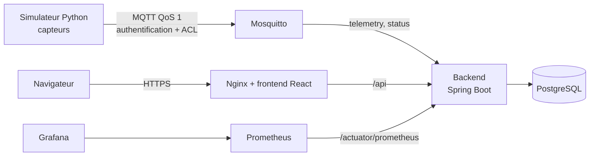

# IoT Cloud Manager

Plateforme de gestion de capteurs IoT basée sur MQTT et le Cloud. Des capteurs simulés publient leurs mesures sur un broker MQTT. Le backend les valide, les enregistre dans PostgreSQL, déclenche des alertes et les expose à une application web. L'ensemble tourne dans des conteneurs Docker sur une machine virtuelle Oracle Cloud, en HTTPS, avec supervision et intégration continue.

Projet d'équipe, sujet n°8 : MQTT et Cloud (15 octobre au 9 décembre 2026).

## Accès

| Ressource | Adresse |
|---|---|
| Application web | https://iot-manager-yahya.duckdns.org |
| Supervision (Grafana, Prometheus) | Tunnel SSH uniquement : ports 3000 et 9090 liés à `127.0.0.1` sur la VM |
| Contrat des messages MQTT | [`CONTRAT_MQTT.md`](CONTRAT_MQTT.md) |

L'accès à l'application demande une connexion. Les identifiants de l'administrateur sont définis dans `deploy/.env` et ne sont jamais versionnés.

## Architecture



Le frontend ne parle jamais MQTT : il passe uniquement par l'API REST du backend. Nginx termine le HTTPS (certificat Let's Encrypt), sert le frontend, relaie `/api/` vers le backend et refuse `/actuator/` depuis Internet.

### Les 7 services Docker Compose

| Service | Rôle | Technologie | Port |
|---|---|---|---|
| `frontend` | Application web et reverse proxy HTTPS | React (Vite), Nginx | 80 et 443 (public) |
| `backend` | API REST, réception MQTT, alertes, état hors ligne | Spring Boot 3, Java 17 | 8080 (`127.0.0.1`) |
| `postgres` | Base de données, volume persistant | PostgreSQL 16 | 5432 (`127.0.0.1`) |
| `mosquitto` | Broker MQTT, sans connexion anonyme, un utilisateur par capteur | Eclipse Mosquitto 2 | 1883 (`127.0.0.1`) |
| `simulator` | Capteurs simulés | Python 3.12, paho-mqtt | aucun |
| `prometheus` | Collecte des métriques du backend | Prometheus | 9090 (`127.0.0.1`) |
| `grafana` | Tableau de bord de supervision | Grafana | 3000 (`127.0.0.1`) |

Seuls les ports 80 et 443 sont accessibles depuis Internet.

## Structure du dépôt

| Dossier | Contenu |
|---|---|
| `backend/` | API REST Spring Boot, réception MQTT, JWT, alertes, tests |
| `frontend/` | Application React, `Dockerfile` et configuration Nginx |
| `simulator/` | Simulateur de capteurs Python et ses tests |
| `deploy/` | `docker-compose.yml`, configuration Mosquitto (ACL), Prometheus et Grafana |
| `.github/workflows/` | Intégration continue GitHub Actions |
| `CONTRAT_MQTT.md` | Contrat des topics et des messages JSON |

## Fonctionnalités

- Réception et validation des mesures MQTT selon le contrat : schéma, plages de valeurs, rejet des doublons (`messageId`), rejet des capteurs inconnus ou désactivés. Chaque rejet est journalisé et compté dans Prometheus (`mqtt_messages_rejected_total`).
- Catalogue de mesures : température, humidité, pression, CO₂, volume d'eau, présence.
- État en ligne ou hors ligne des capteurs, avec message Last Will et passage hors ligne après 3 × `intervalSec` sans télémétrie.
- Gestion des capteurs (création, modification, suppression, activation) depuis l'interface.
- Dernière mesure de chaque capteur, graphiques de l'historique avec filtres par capteur, type et période.
- Seuils d'alerte par capteur et type de mesure, alertes enregistrées et affichées.
- Authentification JWT avec deux rôles, `ADMIN` et `USER` (lecture).
- Supervision : métriques Micrometer, Prometheus et un tableau de bord Grafana.
- Intégration continue : tests du backend, du frontend et du simulateur, construction des images Docker.

## API REST

Toutes les routes, sauf la connexion et `/actuator/health`, demandent l'en-tête `Authorization: Bearer <token>`.

| Méthode et route | Rôle |
|---|---|
| `POST /api/auth/login` | Connexion, retourne le token JWT |
| `GET /api/auth/me` | Utilisateur connecté |
| `GET /api/devices` | Liste des capteurs avec état et dernières mesures |
| `POST /api/devices` | Créer un capteur |
| `GET`, `PUT`, `DELETE /api/devices/{id}` | Consulter, modifier, supprimer un capteur |
| `PATCH /api/devices/{id}/enabled` | Activer ou désactiver un capteur |
| `GET /api/measurements/device/{deviceId}` | Dernières mesures d'un capteur |
| `GET /api/measurements/device/{deviceId}/type/{type}` | Mesures filtrées par type |
| `GET /api/measurements/device/{deviceId}/period?start=&end=` | Mesures filtrées par période (dates ISO) |
| `GET /api/measurement-types` | Catalogue des types de mesures |
| `GET /api/alerts` et `GET /api/alerts/device/{deviceId}` | Alertes |
| `GET`, `POST`, `PUT`, `DELETE /api/alerts/thresholds` | Seuils d'alerte (administrateur) |
| `GET`, `POST`, `PATCH`, `DELETE /api/users` | Gestion des utilisateurs (administrateur) |
| `GET /actuator/health` | État du backend |

## Messages MQTT

| Topic | Sens | Rôle |
|---|---|---|
| `iot/devices/{deviceId}/telemetry` | capteur vers backend | Mesures (QoS 1) |
| `iot/devices/{deviceId}/status` | capteur vers backend | État en ligne ou hors ligne (QoS 1, retain) |

Chaque capteur se connecte avec son `deviceId` comme nom d'utilisateur et ne peut publier que dans ses propres topics (ACL dans `deploy/mosquitto/acl`). Le détail des messages est dans [`CONTRAT_MQTT.md`](CONTRAT_MQTT.md).

## Déploiement sur un serveur

Prérequis : Docker avec Compose, un nom de domaine qui pointe vers le serveur, les ports 80 et 443 ouverts, un certificat Let's Encrypt.

```bash
git clone git@github.com:YahyaHajji/iot-cloud-manager.git
cd iot-cloud-manager/deploy
cp .env.example .env          # remplacer toutes les valeurs CHANGE_ME
# créer les utilisateurs Mosquitto : voir deploy/README.md
docker compose up -d --build
docker compose ps
```

Mise à jour du serveur :

```bash
git pull
cd deploy && docker compose up -d --build
```

Le détail (utilisateurs Mosquitto, certificat HTTPS, simulateur, supervision) est dans [`deploy/README.md`](deploy/README.md).

### Variables d'environnement (`deploy/.env`)

| Variable | Rôle |
|---|---|
| `POSTGRES_DB`, `POSTGRES_USER`, `POSTGRES_PASSWORD` | Base de données |
| `MQTT_USERNAME`, `MQTT_PASSWORD` | Compte MQTT du backend |
| `JWT_SECRET` | Clé de signature des tokens, longue et aléatoire |
| `ADMIN_USERNAME`, `ADMIN_PASSWORD` | Administrateur créé au premier démarrage |
| `CORS_ALLOWED_ORIGINS`, `VITE_API_BASE_URL` | Adresse publique du site |
| `GRAFANA_ADMIN_PASSWORD` | Mot de passe de Grafana |
| `SIMULATOR_SENSORS`, `HEARTBEAT_INTERVAL_SEC`, `ANOMALY_EVERY_N` | Capteurs simulés, avec un mot de passe MQTT chacun |

Le fichier `.env` et le fichier de mots de passe Mosquitto ne sont jamais versionnés.

## Développement en local

```bash
# Backend, base de données, broker et simulateur
cd deploy && docker compose up -d --build mosquitto postgres backend simulator

# Frontend avec rechargement à chaud (mode démonstration sans backend : VITE_DATA_MODE=mock)
cd frontend && npm ci && npm run dev
```

Le service `frontend` du compose utilise le certificat HTTPS du serveur : en local, lancez plutôt le frontend avec `npm run dev`.

## Tests et intégration continue

| Domaine | Commande | Workflow GitHub Actions |
|---|---|---|
| Backend | `cd backend && ./mvnw test` | `Backend` |
| Frontend | `cd frontend && npm ci && npm run lint && npm test && npm run build` | `Frontend` |
| Simulateur | `cd simulator && pip install -r requirements-dev.txt && python -m pytest` | `Simulateur` |
| Images Docker | construction des images et validation du compose | `Images Docker` |

Les quatre contrôles s'exécutent à chaque pull request.

## Règles de travail

- Une branche par fonctionnalité (`feature/nom-court`), jamais de push direct sur `master`.
- Une pull request relue avant la fusion, avec les quatre contrôles verts.
- Ne jamais déposer de mots de passe, de clés SSH ou de fichiers `.env` dans le dépôt.
- Messages de commit clairs, en français ou en anglais.
- Le suivi des tâches se fait sur le tableau Trello de l'équipe.

## Équipe

| Membre | Rôle | Responsabilités |
|---|---|---|
| Khankhour | IoT et MQTT | Contrat des messages, simulateur de capteurs |
| Nisrine | Backend | API Spring Boot, base de données, JWT, alertes |
| Hamza | Frontend | Application React, intégration de l'API |
| Yahya | Cloud et DevOps | Infrastructure Oracle Cloud, Docker, Nginx et HTTPS, sécurité MQTT, CI/CD, supervision |
