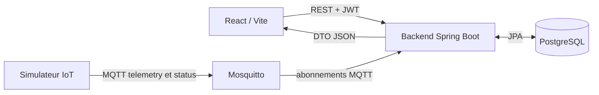

# IoT Cloud Manager — Frontend

## 1. Tâches réalisées

Le tableau reflète le code, les commits présents sur `feature/frontend-api` et les validations exécutées dans l’environnement courant.

| Tâche | Objectif et fonctionnalités livrées | État réel | Commit lié |
| --- | --- | --- | --- |
| 0 — Préparation de la branche | Branche `feature/frontend-api` synchronisée avec la branche principale. | Réalisée ; branche actuelle propre avant la présente modification du README. | `60b1c72` — `merge: synchronize frontend-api with master` |
| 1 — Services API | Centralisation de l’instance Axios, des services et du choix API/mock. | Réalisée ; `servicesLayer.js` est le point d’entrée des services. | `e089717` — `Données et graphiques charts` |
| 2 — Authentification | Connexion JWT, session persistée, protection des routes et déconnexion. | Réalisée dans le code. | `32af889` — `JWT authentication` ; `4fd47d7` — `JWT authentication` |
| 3 — Capteurs | Liste, validation, ajout, modification, suppression, activation et désactivation. | Réalisée dans les services et l’interface. | `0390582` — `devices - Fix CRUD des capteurs` |
| 4 — Dernières mesures | Exploitation de `lastMeasurements` et présentation des valeurs avec unités et dates. | Présente dans l’interface et dans les données de démonstration ; parcours MQTT réel non validé ici. | `98f7e15` — `Affichage dernières mesures dyal capteurs` |
| 5 — Historique des données | Sélection du capteur et du type, période, tableau historique et graphiques. | Réalisée ; appels API par capteur, type ou période. | `e089717` — `Données et graphiques charts` |
| 6 — Alertes | Historique des alertes, filtrage et compteur de sidebar fondé sur les alertes retournées. | Réalisée ; le Backend ne fournit pas d’état actif/résolu, le compteur représente donc l’historique. | `7292012` — `Intégration l'ihstorique des alértes.` |
| 7 — Dashboard | Statistiques, graphiques historiques, alertes récentes, dernières mesures et actualisation périodique. | Réalisée dans le code ; pas de validation d’interface contre un Backend connecté dans cette session. | `f948805` — `Intégration d'API réelle & Statestique denamique.` |
| 8 — Mode mock | Services de démonstration, sessions séparées API/mock, indicateur et documentation de démarrage offline. | Réalisée ; tests de services automatisés sans requête Backend. | `b472be4` — `Finaliser le mode démonstration Offline wkda` |
| 9 — Tests et validation | Lint, tests automatisés et compilation. | Validations automatisées réussies. L’intégration fonctionnelle avec un Backend réel n’a pas été exécutée ici. | `a73d536` — `Valider l’intégration de l’API et le Mock Mode.` |

## 3. Architecture Frontend

### Arborescence de `src/`

```text
src/
├── App.jsx                         # Routes protégées, layout et pages de l’application
├── App.css                         # Styles de l’interface
├── Login.jsx                       # Formulaire de connexion
├── auth.js                         # Session, login/logout et intercepteurs JWT
├── servicesLayer.js                # Mode, instance Axios et services Devices/Alerts/Measurements
├── index.css                       # Styles globaux
├── main.jsx                        # Démarrage React
├── data/
│   └── mockData.js                 # Capteurs, mesures et alertes de démonstration
├── utils/
│   ├── devicesServiceCore.js       # Contrat partagé et service CRUD des capteurs
│   └── sensorValidation.js         # Validation du formulaire capteur
└── assets/                         # Images et ressources statiques
```

Les pages `Dashboard`, `Sensors`, `Devices`, `Alerts` et `DataPage`, ainsi que les composants `Layout`, `Badge` et `SensorForm`, sont définis dans `App.jsx`. Les composants consomment les services ; ils n’importent pas directement `mockData.js`.

`servicesLayer.js` choisit `api` ou `mock` à partir de `VITE_DATA_MODE`. En mode API, les services utilisent la même instance Axios. En mode mock, ils retournent les structures correspondant aux DTO consommés par l’interface et stockent les modifications de capteurs en mémoire.

`auth.js` conserve séparément les sessions API et démonstration. En mode API, l’intercepteur ajoute `Authorization: Bearer …` aux appels authentifiés et traite les réponses HTTP 401. En mode mock, l’intercepteur JWT n’est pas installé.

### Flux de communication



## 4. Installation et démarrage

### Démarrer Backend et simulateur

Depuis le dossier `deploy/`, après préparation de son fichier `.env` selon `deploy/README.md` :

```bash
cd deploy
docker compose up -d postgres mosquitto backend simulator
docker compose ps
```

### Démarrer le Frontend

```bash
cd frontend
npm install
npm run dev
```

Vite sert l’application sur `http://localhost:5173` par défaut (ou indique une autre adresse si le port est occupé).

## 5. Mode API — Données réelles
Configurer `frontend/.env` :
```env
VITE_API_BASE_URL=http://localhost:8080
VITE_DATA_MODE=api
```
`frontend/.env.example` conserve ces valeurs, avec `api` comme mode par défaut.

### Endpoints utilisés par le Frontend

Les chemins sont ceux appelés par le code actuel. Les opérations Capteurs utilisent l’identifiant numérique `id` renvoyé par l’API.

| Méthode | Endpoint | Usage |
| --- | --- | --- |
| `POST` | `/api/auth/login` | Authentifier l’utilisateur et récupérer le JWT. |
| `GET` | `/api/devices` | Lister les capteurs et leurs dernières mesures. |
| `POST` | `/api/devices` | Créer un capteur. |
| `PUT` | `/api/devices/{id}` | Modifier un capteur. |
| `PATCH` | `/api/devices/{id}/enabled` | Activer ou désactiver un capteur. |
| `DELETE` | `/api/devices/{id}` | Supprimer un capteur. |
| `GET` | `/api/measurement-types` | Récupérer les types de mesure disponibles. |
| `GET` | `/api/measurements/device/{deviceId}` | Récupérer l’historique d’un capteur. |
| `GET` | `/api/measurements/device/{deviceId}/type/{type}` | Filtrer l’historique par type. |
| `GET` | `/api/measurements/device/{deviceId}/period?start=…&end=…` | Récupérer les mesures d’une période. |
| `GET` | `/api/alerts` | Récupérer l’historique des alertes. |
| `GET` | `/api/alerts/device/{deviceId}` | Récupérer les alertes d’un capteur. |

Le Frontend n’appelle pas les endpoints de gestion des seuils. Les routes `GET /api/devices/{id}` et `GET /api/devices/device/{deviceId}` ne sont pas utilisées par les services Frontend actuels.

### Scénarios fonctionnels en mode API

**Statut réel :** aucune session avec un vrai Backend et aucun scénario manuel navigateur/API n’ont été exécutés dans cette validation. Les tests automatisés d’API décrits comme simulés remplacent Axios par un adaptateur local ; ils ne prouvent pas la disponibilité du Backend, PostgreSQL ou MQTT.

| ID | Fonctionnalité | Action | Résultat attendu | Statut constaté |
| --- | --- | --- | --- | --- |
| API-01 | Connexion valide | Se connecter avec un compte Backend actif. | Réponse contenant un JWT, puis accès au Dashboard. | Connexion réussie vérifiée avec Axios simulé ; compte réel non testé. |
| API-02 | Connexion invalide | Entrer un mot de passe incorrect. | Message d’authentification refusée ; aucune session ouverte. | Non testé contre le Backend réel. |
| API-03 | Persistance de session | Recharger l’onglet après connexion. | Session API relue et routes privées maintenues accessibles tant que le JWT est valable. | Persistance implémentée via stockage local ; rechargement navigateur non testé. |
| API-04 | Protection des routes | Ouvrir `/dashboard` sans session. | Redirection vers `/login`. | Protection présente dans `AuthGate` ; navigation navigateur non testée. |
| API-05 | Déconnexion / HTTP 401 | Se déconnecter, puis provoquer une réponse 401 authentifiée. | Session supprimée et retour à la connexion. | Déconnexion mock testée ; scénario HTTP 401 réel non testé. |
| API-06 | Liste des capteurs | Ouvrir Capteurs. | Liste provenant de `GET /api/devices`. | Service API vérifié avec Axios simulé ; Backend réel non testé. |
| API-07 | Création, modification, suppression | Effectuer les trois opérations depuis Capteurs. | Les changements sont persistés par les routes POST, PUT et DELETE. | Appels du service vérifiés avec Axios simulé ; formulaire et persistance réelle non testés. |
| API-08 | Activation / désactivation | Basculer l’état d’un capteur. | `PATCH /api/devices/{id}/enabled` met à jour l’état. | Appel du service vérifié avec Axios simulé ; Backend réel non testé. |
| API-09 | Dernières mesures MQTT | Publier une télémétrie puis ouvrir les détails/Dashboard. | Mesure, unité et horodatage apparaissent après réception côté Backend. | Données mock couvertes ; publication MQTT et affichage réel non testés. |
| API-10 | Historique et graphiques | Ouvrir Données et consulter une série. | Les mesures API sont triées et tracées par capteur et type. | Services de lecture vérifiés avec Axios simulé ; graphique navigateur non testé. |
| API-11 | Filtres capteur, type et période | Choisir un capteur, un type et une période. | Les résultats correspondent aux filtres sélectionnés. | Appels type/période simulés vérifiés ; filtre d’interface contre Backend non testé. |
| API-12 | Tous les capteurs | Choisir « Tous les capteurs » dans Données. | Les séries des capteurs chargés sont affichées. | Implémenté dans l’interface ; scénario navigateur non testé. |
| API-13 | Historique des alertes | Ouvrir Alertes et filtrer par capteur. | Données issues de `/api/alerts` ou `/device/{deviceId}`. | Services list/byDevice vérifiés avec Axios simulé ; Backend réel non testé. |
| API-14 | Compteur de sidebar | Comparer le compteur au nombre d’alertes reçues. | Le compteur représente l’historique renvoyé, pas des alertes actives. | Liaison présente dans le code ; test d’interface non exécuté. |
| API-15 | Statistiques / actualisation Dashboard | Ouvrir le Dashboard et attendre 10 secondes. | Statistiques API actualisées sans requêtes concurrentes. | Implémenté ; test d’interface contre Backend réel non exécuté. |
| API-16 | Erreur réseau | Arrêter le Backend puis charger une page API. | Erreur affichée avec possibilité de réessayer ; pas de données mock injectées. | Rejet API et absence de fallback vérifiés avec adaptateur simulé ; panne réelle non testée. |
| API-17 | Pas de bascule mock | Provoquer une erreur API. | Le mode reste `api` et la requête échoue visiblement. | Vérifié par test automatisé Axios simulé. |

## 6. Mode mock — Secours pour la soutenance

Dans `frontend/.env`, utiliser :

```env
VITE_DATA_MODE=mock
```

Identifiants de démonstration :

| Champ | Valeur |
| --- | --- |
| Username | `demo` |
| Password | `demo` |

Le mode mock accepte aussi d’autres identifiants non vides. Il fonctionne sans Backend, Docker, PostgreSQL ni MQTT : les services renvoient les fixtures locales et les modifications CRUD des capteurs sont gardées en mémoire jusqu’au rechargement de l’application. Aucun token mock n’est généré ni envoyé au Backend ; les sessions mock et API sont stockées séparément.

Après un changement de `VITE_DATA_MODE`, **redémarrer Vite**. Pour une version compilée, relancer `npm run build` avec la variable souhaitée puis redéployer l’artefact. Pour revenir au mode API, remettre `VITE_DATA_MODE=api` (ou supprimer cette variable), redémarrer Vite et se connecter avec un compte Backend.

### Scénarios fonctionnels en mode mock

| ID | Fonctionnalité | Action | Résultat attendu | Statut constaté |
| --- | --- | --- | --- | --- |
| MOCK-01 | Connexion / déconnexion | Se connecter avec `demo` / `demo`, puis se déconnecter. | Session démonstration créée puis effacée. | Login/logout du service vérifiés automatiquement ; parcours visuel non testé. |
| MOCK-02 | Protection des routes | Ouvrir une route privée sans session, puis après connexion. | Redirection avant connexion ; accès après connexion. | `AuthGate` est présent ; navigation navigateur non testée. |
| MOCK-03 | Indicateur | Consulter la sidebar en mode mock puis API. | « Mode démonstration » apparaît uniquement en mock. | Condition présente dans le code ; rendu navigateur non testé. |
| MOCK-04 | Dashboard et statistiques | Ouvrir le Dashboard puis ajouter/supprimer un capteur. | Cartes calculées à partir des services ; le total évolue après actualisation. | Services et CRUD testés ; rendu et agrégats React non couverts par les tests. |
| MOCK-05 | CRUD capteurs | Créer, modifier et supprimer un capteur. | Liste mémoire mise à jour avec `id`, `deviceId`, `enabled`, `status` et mesures. | CRUD mémoire vérifié automatiquement. |
| MOCK-06 | Activation / désactivation | Basculer le champ enabled. | L’état retourné et relu par le service est modifié. | Vérifié automatiquement sur le service mock. |
| MOCK-07 | Dernières mesures | Consulter les dernières mesures disponibles. | Les valeurs et horodatages des fixtures sont exposés par `lastMeasurements`. | Structure de données vérifiée ; interface non testée au navigateur. |
| MOCK-08 | Historique et graphiques | Ouvrir Données et sélectionner un type. | Les mesures mock sont exposées avec `measuredAt` et valeurs/unités. | Service et filtrage vérifiés ; tracé graphique visuel non testé. |
| MOCK-09 | Filtres | Filtrer par capteur, type et période. | Le service retourne les mesures correspondant aux critères. | Filtrage service par capteur/type/période couvert ; interactions UI non testées. |
| MOCK-10 | Alertes et compteur | Ouvrir l’historique et vérifier le compteur. | Les alertes suivent le DTO et le compteur utilise leur nombre. | Liste et alertes par capteur vérifiées ; compteur React non testé séparément. |
| MOCK-11 | Zéro requête Backend | Charger les services mock, lire les données et effectuer CRUD/login. | Aucun appel ne passe par l’adaptateur Axios. | Vérifié automatiquement : zéro appel enregistré pendant le test mock. |
| MOCK-12 | Sessions indépendantes | Précharger une session API puis utiliser le mode mock, et inversement. | Aucun token ou session d’un mode n’est réutilisé par l’autre. | Séparation mock/API et absence de token mock vérifiées automatiquement. |

## 7. Tests techniques

Commandes exécutées dans `frontend/` :

```bash
npm run lint
npm run test
npm run build
```

| Commande | Résultat de cette validation |
| --- | --- |
| `npm run lint` | Réussi, aucune erreur ESLint. |
| `npm run test` | Réussi : **7 tests, 7 réussis, 0 échec**. Deux tests chargent les services avec Vite et un adaptateur Axios simulé ; les autres couvrent validation et services capteurs. |
| `npm run build` | Réussi en mode API par défaut. Bundle JS : environ **750,53 kB** (226,67 kB gzip). Vite avertit que des chunks minifiés dépassent 500 kB. |

Ces tests automatisés ne sont pas des tests fonctionnels avec le Backend réel. Aucun test manuel connecté à Spring Boot/PostgreSQL, aucun échange MQTT complet et aucun test end-to-end navigateur ne sont déclarés comme exécutés pour cette validation.

## 9. Limitations connues

- **Taille du bundle :** Vite émet toujours un avertissement pour les chunks JavaScript supérieurs à 500 kB ; la compilation reste réussie.
- **Seuils d’alerte :** les routes Backend de configuration existent, mais aucune interface Frontend de gestion des seuils n’est implémentée.
- **Validation réelle :** les tests Axios simulés et les builds passent, mais l’authentification avec un vrai compte, les opérations contre le Backend, PostgreSQL et le flux MQTT complet n’ont pas été vérifiés ici.
- **Tests navigateur :** le projet n’inclut pas de suite end-to-end React/browser ; les états visuels, redirections et interactions décrits dans les scénarios restent à valider manuellement.
- **Persistance mock :** les opérations CRUD sont en mémoire et ne survivent pas au rechargement de la page.
- **Périodes API :** le contrôleur Backend exige `start` et `end` pour la route `/period` ; une recherche avec une seule borne n’a pas été validée et peut être rejetée.
